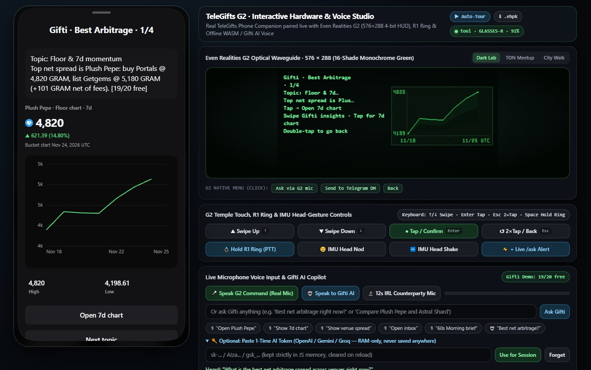
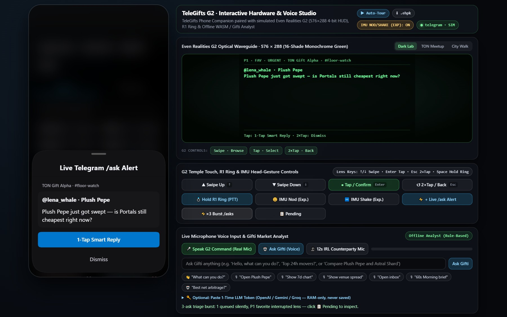
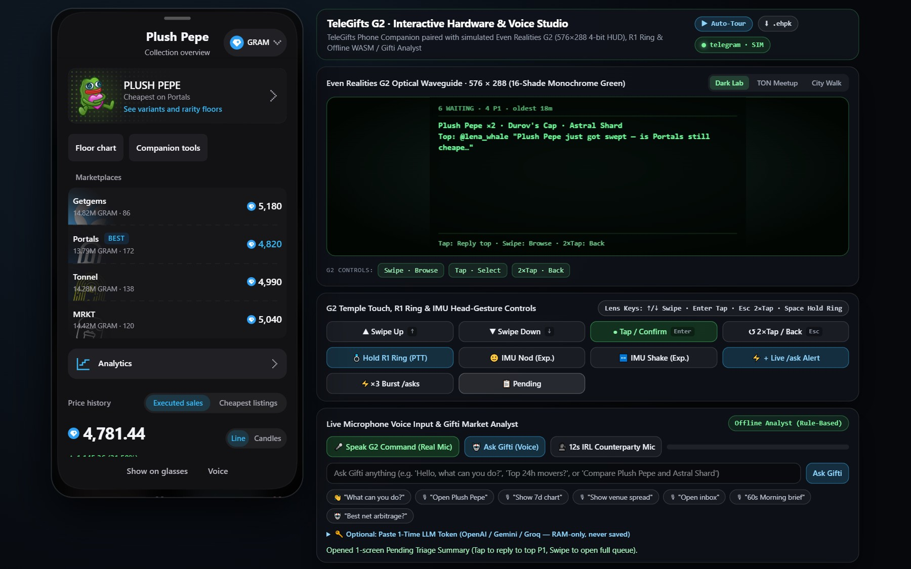
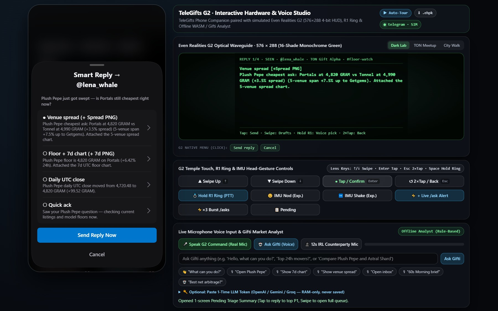

# TeleGifts G2 — Heads-Up Telegram Collectibles & Moderator HUD for Even Realities G2

TeleGifts G2 brings Telegram Gift collectibles, cross-venue floor analytics, and 1-tap moderator replies onto the **Even Realities G2** (`576 × 288` 4-bit optical waveguide) and **Even R1 Ring**. A collector posts `/ask` in a Telegram group, a heads-up alert appears on the G2 lens, and you reply with a grounded 7-day chart or 5-venue spread PNG in one tap or voice command. Built for the **[Heads Up: Even Realities Hackathon](https://dorahacks.io/hackathon/even-realities/detail)** (`Track 01 — Messaging & News` · `Best Telegram Integration`).

- **Live Interactive G2 Studio (GitHub Pages):** https://kingkej.github.io/telegifts-g2-sample/ *(desktop browser ≥920px, zero API keys required)*
- **Full Narrated Split-Screen Demo (`01:59`, 1080p, Live Telegram):** [demo/telegifts-g2-demo.mp4](./demo/telegifts-g2-demo.mp4) · **Live Loop Highlight (`00:37`):** [demo/telegram-live-loop.mp4](./demo/telegram-live-loop.mp4)
- **Full Submission Brief:** [SUBMISSION.md](./SUBMISSION.md)


| 5-Venue Spread Bar Chart (`256×144`) | Gifti Cross-Venue Arbitrage Analyst | Answer-First Triage (`P1 · FAV · URGENT`) |
| --- | --- | --- |
|  |  |  |

| 1-Screen `Pending` Quiet Summary | Intent-Ranked Smart Reply (`· SEEN`) | Full HQ Narrated Demo (Live Telegram) |
| --- | --- | --- |
|  |  | **[Watch Full Demo `01:59`](./demo/telegifts-g2-demo.mp4)** · **[Live Loop `00:37`](./demo/telegram-live-loop.mp4)** · **[Try Live Studio](https://kingkej.github.io/telegifts-g2-sample/)** |

---

## 1. What's Live vs. Demo / Experimental

| Capability | Status | Details |
| --- | --- | --- |
| **G2 `576 × 288` Spatial HUD, Charts & Voice Grammar** | **Live (Offline)** | SDK `0.0.16` validated 3-region HUD (`textColor` `2 / 4 / 3`), `256 × 144` UTC floor & 5-venue spread charts, 3D relief preview, deterministic P1/P2/P3 Answer-First Triage + 1-screen `Pending` summary, and offline SoundSwallower WASM JSGF speech recognition. |
| **TON/USDT Spot Rate & On-Chain Portfolio** | **Live Holdings + Snapshot Pricing** | Live CoinGecko TON/USDT spot ticker (offline fallback); real on-chain Telegram Gift NFT holdings for TON addresses (`EQ...` / `UQ...` / `.ton`) and Fragment collectible usernames (`@name` / `name.t.me` via TonAPI DNS owner lookup), priced against the bundled snapshot unless `VITE_MARKET_API_URL` is configured. `@collector` / `@ton_alpha` are labeled synthetic demo portfolios. |
| **Telegram Bot Relay (`server/telegramRelay.mjs`)** | **Live (Self-Hosted)** | Real Bot API pairing (`/start`), forum topic `/ask` & reply-to-bot follow-up capture, Live Loop `👀` / `👍` reactions & typing/upload actions (`/g2/telegram/ack`), `sendMessage` / `sendPhoto` (`floor-chart.png` / `venue-spread.png`), inline `callback_query` buttons, Inline Mode (`@bot <gift>` snapshot cards via `answerInlineQuery`), optional atomic `RELAY_STATE_FILE` persistence, and SSE push with immediate long-poll re-polling. Requires your own Bot token locally or on a personal server. |
| **Gifti Analyst & Dictate-or-Draft Composer** | **Offline Rule-Based + Optional Live LLM** | Unlimited local rule-based analyst and grounded smart-reply drafts out of the box (no quota, no key). Paste an optional 1-time RAM-only OpenAI (`sk-...`), Gemini (`AIza...`), or Groq (`gsk_...`) key for live LLM answers, strict number-grounded AI reply drafts, and free-form R1 Ring voice dictation (always Tap-to-send). |
| **Gift Market Catalog & Simulated Inbox** | **Bundled Snapshot (Overrideable)** | Ships with a deterministic Nov 24, 2026 24-collection multi-venue snapshot and demo `/ask` questions so judges can test zero-key. Set `VITE_MARKET_API_URL` to connect a live feed; live Telegram replies and inline cards mark snapshot data with `(snapshot)`. |
| **IMU Head-Nod Triage & IRL `speakerRole=other`** | **Experimental (Simulator-Verified)** | Verified end-to-end in the browser Studio, Even Hub Simulator, and automated tests (`259` tests). Not yet calibrated against physical Even Realities G2 hardware traces. |

---

## 2. Quick Start (Zero Keys Required)

```bash
npm install
npm run dev
```

Open `http://localhost:3000` on desktop (`?raw=1` shows only the phone view; `?studio=1` forces the side-by-side G2 Studio on narrow screens):
1. Click **▶ Auto-Tour** for a guided walkthrough, or click the lens and use `↑/↓` (Swipe), `Enter` (Tap), `Esc` (2×Tap), and `Space` (Hold R1 Ring).
2. Test **🎤 Speak G2 Command (Real Mic)** for offline `16 kHz` WASM speech recognition, or type/speak to the **Offline Gifti Analyst** (and optionally paste a 1-time RAM-only OpenAI / Gemini / Groq key).
3. Click **⚡ + Live /ask Alert**, **⚡×3 Burst /asks**, or **📋 Pending** (or open **Explore → Telegram Setup**) to test deterministic P1/P2/P3 triage, silent P3 queuing vs. P1 heads-up interrupts, intent-ranked 1-tap Smart Replies with 7d/spread PNGs, `t.me/nft/PlushPepe-412` quick-beam, and all **9 Collector Copilot tools**.
4. In **Tools → User portfolio**, try `@collector` (labeled synthetic demo) or any real public TON wallet (`EQ...` / `UQ...` / `.ton`) or Fragment collectible `@username`.

### Official Even Hub Simulator
```bash
# Terminal 1
npm run dev

# Terminal 2
npm run simulate
```

### Build & Package `.ehpk`
```bash
npm run build
npm run pack
```
Produces `telegifts-g2.ehpk` validated against `app.json` (SDK `0.0.16`).

---

## 3. Optional Live Telegram Bot Relay (`server/telegramRelay.mjs`)

Connect a real Telegram Bot while keeping `TELEGRAM_BOT_TOKEN` strictly server-side:

```bash
cp .env.example .env
# Set TELEGRAM_BOT_TOKEN and TELEGRAM_BOT_USERNAME in .env (never committed).
# Optional: set RELAY_ALLOWED_CHANNELS=-100123456,@yourchannel to allow channel_post digest headlines.
# Optional: set RELAY_STATE_FILE=.relay-state.json to persist pairing/questions/offset across restarts (never stores secrets or receipts).
# Optional: set RELAY_REACTIONS=0 to disable 👀/👍 Live Loop reactions & typing indicators (enabled by default).
# Optional Inline Mode: run /setinline in @BotFather for your bot so typing `@yourbot plush` in any Telegram chat shares grounded snapshot cards.

# Terminal 1 — start local Bot API relay on localhost:8787
npm run relay

# Terminal 2 — point Vite at the relay (bash/zsh)
VITE_TELEGRAM_RELAY_URL=http://localhost:8787 npm run dev
```

On Windows PowerShell (Terminal 2):
```powershell
$env:VITE_TELEGRAM_RELAY_URL = 'http://localhost:8787'; npm run dev
```

**Deploying for Even Realities Mobile App:**
- Never bake shared relay tokens into a distributed `.ehpk`. Run `server/telegramRelay.mjs` with `RELAY_HOST=0.0.0.0` behind an HTTPS reverse proxy and `RELAY_AUTH_TOKEN` set in `.env`, then enter your Relay URL and Bearer Token at runtime under **Explore → Telegram Setup**.
- Add your HTTPS relay origin to `permissions[1].whitelist` in `app.json` before running `npm run pack`; `https://api.telegram.org` stays strictly server-side.

---

## 4. Key Architecture & G2 Controls

- **Multi-Container Spatial HUD (`src/hudLayout.ts`, `src/glasses.ts`):** Uses SDK `0.0.16` `validateEvenHubPageContainer` with muted single-line header (`textColor: 2`, `zOrderIndex: 1`, 72-byte cap), bright focal body (`textColor: 4`, `zOrderIndex: 2`, `isEventCapture: 1`), medium footer (`textColor: 3`, `zOrderIndex: 3`), and `120 × 120` / `256 × 144` grayscale PNG container (`zOrderIndex: 4`).
- **4 Visual Inspection Modes (`src/inspection.ts`):** 3D relief & procedural cup model (`src/giftPreview.ts`), `24h / 7d / 30d` UTC floor history (`src/floorChart.ts`), 5-venue spread bar chart (`src/spreadChart.ts`), and model/rarity browser.
- **Telegram Moderator Loop (`src/services/telegramStore.ts`, `src/services/questionTriage.ts`, `src/services/smartReplies.ts`, `server/telegramRelay.mjs`):** Deterministic Answer-First P1/P2/P3 triage (known collection, Favorites, Watchlist, venue spread, urgency, follow-ups, age) with non-destructive interrupt policy and 1-screen `Pending` summary; authenticated SSE push (`/g2/telegram/events`), Live Loop `👀` / `👍` reactions & topic-aware typing/upload actions (`/g2/telegram/ack`), reply-to-bot follow-ups, Inline Mode (`@bot <gift>`), intent-ranked 1-tap Smart Replies (`Floor + 7d chart`, `Venue spread`, `Daily UTC close`, `Quick ack`, plus optional number-grounded AI draft), R1 Ring PTT draft picker / free-form dictation (Tap-to-send), atomic `RELAY_STATE_FILE` persistence, and idempotent delivery receipts.
- **Hardware Hooks (`src/imuGestureTriage.ts`, `src/services/evenHostStorage.ts`, `src/lib/giftLinkResolver.ts`):** Power-gated experimental IMU head-nod/shake alert triage (enabled only while an alert is on-screen), bounded 12s IRL `speakerRole=other` lookup, `glassesMenu` Morning Brief launch, Even host storage sync, `t.me/nft/...` quick-beam, and album filename lookup via `pickImageFromAlbum()`.
- **Offline Speech Grammar (`src/voiceRecognitionGrammar.ts`, `soundswallower`):** Zero-key JSGF commands (*"Open Plush Pepe"*, *"Show the 7d chart"*, *"Show venue spread"*, *"Open inbox"*, *"Venue spread draft"*, *"Send reply"*, *"What changed in my favorites"*, etc.).

| Screen | Swipe Up / Down | Single Tap / Head Nod | Hold (Temple / R1 Ring) | Double-Tap / Head Shake |
| --- | --- | --- | --- | --- |
| **Explore / Favorites** | Previous / Next collection | Open gift details | Open Favorites | TeleGifts Menu / Explore |
| **Gift Detail** | Up: 3D Relief · Down: Floor Chart | Save / Remove Favorite | Browse Models | Back to list |
| **Floor / Spread Chart** | Switch `24h ↔ 7d ↔ 30d` / Floor | Switch to 3D Relief / Floor | — (`Menu` → Share / Spread) | Back to Detail |
| **`LIVE /ASK` Heads-Up Alert** | — | **Tap or Nod (Exp.): Smart Reply (sends `👀`)** | — | **2×Tap or Shake (Exp.): Dismiss** |
| **Pending Triage (`pending`)** | Open full sorted queue | **Tap: Reply to top P1** | — | Back |
| **Smart Reply (`compose`)** | Cycle intent-ranked drafts | **1-Tap Send Reply (marks `👍`)** | **Hold R1: Dictate (LLM) / Voice Pick (Offline)** | Back to Question |
| **Channel Digest (`digest`)** | Browse breakout & watch alerts | **Save alert to Telegram DM** | — | Back |

---

## 5. Verification & Public Repo Hygiene

```bash
npm test            # Unit, HUD, voice, portfolio, and Telegram relay test suite
npm run build       # TypeScript typecheck + production Vite bundle
npm run audit:public # Scans tracked workspace files for secrets, keystores, and manifest rules
```

---

## 6. Hackathon Transparency Disclosure & Licensing

Per the **Heads Up: Even Realities Hackathon** rules:
- **Git history note:** This public repository was published on Nov 25, 2026 from a squashed clean export (to strip private internal monorepo paths and credentials before open release).
- **Licensing note:** All source code, tests, scripts, and docs outside `vendor/telegifts-phone/` are MIT-licensed ([LICENSE](./LICENSE)). The pre-built, sourcemap-free companion UI bundle in `vendor/telegifts-phone/` is proprietary and included solely for running and evaluating TeleGifts G2 (see [vendor/telegifts-phone/NOTICE](./vendor/telegifts-phone/NOTICE)).

| Area | Pre-Nov 23 Internal Baseline | Built / Redesigned During Hackathon (Nov 23–29, 2026) |
| --- | --- | --- |
| **Standalone Architecture** | G2 display module coupled to private monorepo | Standalone zero-secret public repo, contracts (`src/contracts/*`), 24-collection snapshot & 113-gift artwork registry, and automated hygiene audit (`scripts/auditPublicRepo.mjs`) |
| **Companion Bridge & Judge Studio** | Lived outside this repo | `@telegifts/host-bridge` (`phoneHostBridge.ts`), public TonAPI wallet & `.t.me` portfolio lookup (`tonPortfolio.ts`), GitHub Pages G2 Optical Waveguide Studio (`studioShell.ts`, `browserEvenBridge.ts`), and offline rule-based Gifti analyst + 1-time RAM-only LLM bridge (`giftiAiBridge.ts`) |
| **G2 Spatial HUD & Hardware Hooks** | Single text container + single image slot | 3-region brightness-graded multi-container HUD (`hudLayout.ts`), experimental power-gated IMU triage (`imuGestureTriage.ts`), bounded 12s IRL overheard lookup, `glassesMenu` Morning Brief launch, host storage sync (`evenHostStorage.ts`), and `t.me/nft/...` quick-beam |
| **Visual Inspection** | `256 × 144` floor chart, 3D relief/cup preview, model browser | New `256 × 144` 16-shade 5-venue Spread Bar Chart (`src/spreadChart.ts`) and shaded floor plots |
| **Telegram Integration** | Topic-aware chart/comparison confirm & result screens | Standalone `TelegramCompanionStore`, Answer-First P1/P2/P3 triage (`questionTriage.ts`) & 1-screen `Pending` summary, SSE `/g2/telegram/events` push + `LIVE /ASK` interrupt, Live Loop `👀`/`👍` reactions & topic typing (`/g2/telegram/ack`), intent-ranked 1-tap Smart Reply composer (`sendPhoto` 7d + spread PNGs + inline buttons), R1 Ring PTT Dictate-or-Draft composer (number-grounded, Tap-to-send), Inline Mode (`@bot <gift>`), reply-to-bot follow-ups, Channel & Watch Digest, atomic `RELAY_STATE_FILE` persistence, and self-hosted `server/telegramRelay.mjs` |
| **Collector Copilot & Ticker** | Offline SoundSwallower JSGF recognizer + external tool adapters | 9-tool `createCollectorToolbox` (`collectorTools.ts`), live zero-key CoinGecko TON/USDT ticker (`liveTicker.ts`), and expanded JSGF + overheard grammars |
