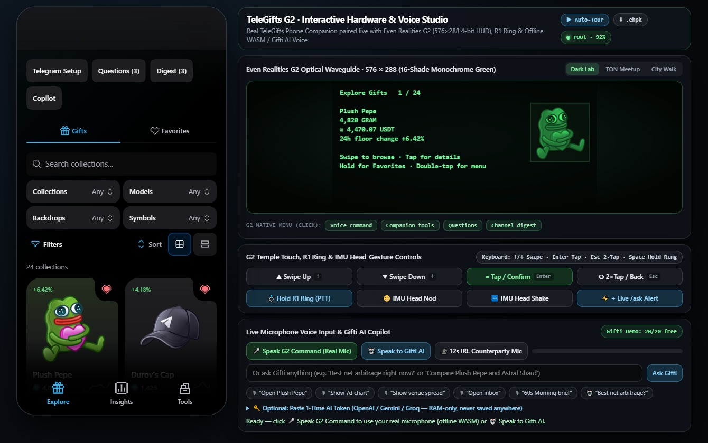
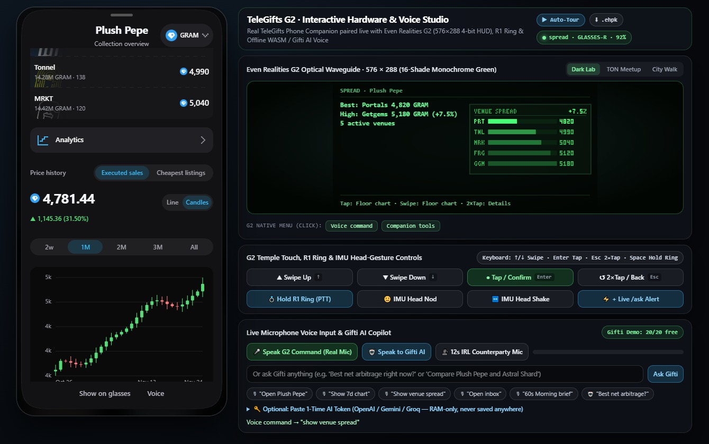

# TeleGifts G2 — Heads-Up Telegram Collectibles & Moderator HUD for Even Realities G2

Built for the **[Heads Up: Even Realities Hackathon](https://dorahacks.io/hackathon/even-realities/detail)**
- **Primary Track:** `Track 01 — Messaging & News` (`Telegram`: accounts, bots, channels, Mini Apps)
- **Cross-Track Category:** `Best Telegram Integration`

TeleGifts G2 brings Telegram Gift collectibles, cross-venue floor analytics, channel breakout digests, and 1-tap moderator replies onto the **Even Realities G2** `576 × 288` 4-bit monochrome optical waveguide — paired with a faithful dark-glass TeleGifts Phone Companion and **Even R1 Ring** push-to-talk controls.



| 5-Venue Spread Chart & Candlestick History | Gifti AI Cross-Venue Arbitrage Copilot | Live `/ask` SSE Interrupt & IMU Head-Nod |
| --- | --- | --- |
|  |  |  |

---

## 1. Problem & Why Smart Glasses

Telegram Gift collectors and community moderators live inside fast-moving Telegram supergroups, forum topics (`#floor-watch`, `#deals-radar`, `#model-checks`), and alert channels. Pulling out a phone every two minutes to check whether a listing floor moved across **Portals, Tonnel, MRKT, Getgems, and Fragment** — or typing repetitive price answers to group `/ask` questions — breaks real-world focus.

**TeleGifts G2** turns the glasses into a calm, heads-up Read + Write Telegram companion:
- **Read at a glance:** Multi-container spatial HUD (`textColor` brightness hierarchy `2 / 4 / 3`) displays listing floors in GRAM + USDT, `256 × 144` UTC floor charts (`24h / 7d / 30d`), cross-marketplace spread bar charts, 3D relief/model rotations, and incoming Telegram channel digests.
- **Write in one gesture or spoken command:** Triage group `/ask` questions by forum topic, swipe through grounded reply drafts (with real `256 × 144` 7d PNG chart attachment or exact BigInt UTC daily close delta), hold the **R1 Ring** to voice-pick a draft or quick-send via offline JSGF speech recognition, or tap once to reply directly in the Telegram thread.

---

## 2. Key Features

### Even Realities G2 HUD (`576 × 288`, 4-bit Grayscale)
- **Multi-Container Spatial HUD (`src/hudLayout.ts`):** Uses SDK `0.0.16` multi-container layouts with muted top status chrome (`textColor: 2`, `zOrderIndex: 1`), bright event-capturing focal readout (`textColor: 4`, `zOrderIndex: 2`, `isEventCapture: 1`), medium action bar (`textColor: 3`, `zOrderIndex: 3`), and dedicated `120 × 120` / `256 × 144` bitmap plane (`zOrderIndex: 4`).
- **4 Visual Inspection Modes (`src/inspection.ts`):**
  1. **3D Relief & Procedural Model Preview (`src/giftPreview.ts`)** — Tilted 16-shade relief projection of bundled gift illustrations + multi-angle 3D cup renderer.
  2. **UTC Floor History Chart (`src/floorChart.ts`)** — `24h` (15m buckets), `7d`, and `30d` (UTC daily buckets) with subtle area shading and gap-honest segments.
  3. **Cross-Venue Spread Chart (`src/spreadChart.ts`)** — Horizontal 16-shade bar chart comparing `Portals`, `Tonnel`, `MRKT`, `Getgems`, and `Fragment` asks.
  4. **Model & Rarity Browser** — Swipe through collection variants and project any variant into 3D relief.
- **Topic-Aware Telegram Moderator Loop & Real-Time SSE Push (`src/services/telegramStore.ts`, `src/services/smartReplies.ts`, `server/telegramRelay.mjs`):**
  - **Sub-Second SSE Live Interrupts (`/g2/telegram/events`):** Streams authenticated real-time Bot API updates to the companion and surfaces a non-destructive `LIVE /ASK` heads-up alert on G2 (`Tap: 1-Tap Smart Reply · 2×Tap: Dismiss`) the moment a collector posts `/ask` or taps an inline card button.
  - **1-Tap Visual Smart Reply Composer (`compose`):** Automatically detects the gift collection mentioned in the question and generates grounded replies (`Floor + 7d chart` with `256 × 144` 7d PNG attachment, `Venue spread` with `256 × 144` 5-venue bar chart PNG attachment, `Daily UTC close`, `Checking listings`) plus interactive Telegram inline buttons (`🔄 Ask Live Floor`, `📌 Pin to Digest`) handled via `callback_query`. Live relay mode strictly separates live observations from paper/demo curves so synthetic 7d closes or spreads are never posted as live facts.
  - **R1 Ring Push-To-Talk Draft Picker:** Hold R1 Ring (`LONG_PRESS_EVENT` → `LONG_PRESS_RELEASE_EVENT` with `EventSourceType.TOUCH_EVENT_FROM_RING`) on `compose` to select drafts or send hands-free (*“venue spread draft”*, *“floor chart draft”*, *“daily close draft”*, *“next draft”*, *“send reply”*), fenced against question/screen changes while transcription finishes.
  - **Idempotent Commit & Delivery Receipt Safety:** Stale container IDs, unacknowledged BLE rebuilds, missing/deleted Telegram threads (`missing_reply`), and concurrent duplicate `requestId`s are strictly fenced end-to-end.
- **Full 9-Tool Collector Copilot Suite (`src/services/collectorTools.ts`, `src/services/liveTicker.ts`):**
  - **60s Morning Market Brief (`summary`):** 4-card swipeable executive briefing (Health/Greed pulse + live CoinGecko TON/USDT spot rate with offline fallback, top 24h breakout + 7d chart, widest net-of-fee arbitrage, and moderator/watch queue).
  - **Talk to Gifti Copilot (`gifti`):** Voice (`ask Gifti` on G2 microphone) and preset intelligence cards covering momentum, net-of-fee venue arbitrage, whale/supply concentration, and rare model permille tiers (`‰`).
  - **Watchlist & USDT Valuation (`watchlist`), Net Arbitrage & Rarity Research (`research`), and Alpha Market Note (`market-note`):** Track baseline entry floors (`record floor`, `add to watchlist`), calculate seller-fee-adjusted arbitrage across 5 marketplaces, and dispatch visual callouts (`+7d PNG` / `+Spread PNG`) to Telegram `Saved Messages` or paired collector groups.
  - **Channel & Price Watch Digest (`digest`, `favorite-movers`, `spread-radar`, `threshold`):** Arm `-3% / -5% / -10%` floor drop watches in one swipe; watches evaluate automatically on live catalog updates, land in the G2 **Channel & Deal Digest**, and forward to Telegram `Saved Messages` via a single tap.
- **Signature Even G2 Hardware Hooks (`src/imuGestureTriage.ts`, `src/services/evenHostStorage.ts`, `src/lib/giftLinkResolver.ts`):**
  - **Power-Gated IMU Head-Nod Alert Triage (`imuControl`):** Enables `IMU_DATA_REPORT` strictly while a transient `LIVE /ASK` or Watch-Hit (`digest-watch-*`) alert is on-screen — **nod** to open Smart Reply / Save to DM, **shake** to dismiss, with zero idle battery drain.
  - **IRL Collector Meetup Lookup (`AudioSpeakerRole.Other` + 12s Hardware Listen):** Bounded 12-second G2 mic listen session (`startIrlListen`) and opt-in `speakerRole === 'other'` spotting via dedicated offline WASM grammar (`overheardCollectionGrammar`) that auto-closes the mic and beams the mentioned gift's 5-venue spread onto your G2 lens without interfering with wearer voice commands.
  - **`glassesMenu` Instant Brief & Native Host Storage:** Early capture of `evenAppLaunchSource` (`glassesMenu`) opens directly into the **60s Morning Market Brief**, while `EvenAppBridge.getLocalStorage` / `setLocalStorage` hydrates and writes through Favorites, Watchlist baselines, Relay config, and hardware toggles across WebView reloads.
  - **Quick-Beam `t.me/nft/...` Gift Link & Album Scanner:** Paste any `https://t.me/nft/PlushPepe-412` or `tg://nft?slug=...` collectible link (or pick an image via `EvenAppBridge.pickImageFromAlbum`) in **Explore → Telegram Setup** to jump straight to that gift and beam its 5-venue spread or research card to G2.
- **Offline On-Device Speech Grammar (`src/voiceRecognitionGrammar.ts`, `soundswallower`):**
  - Zero cloud API keys required. Supports finite-state JSGF commands including:
    - *“Open Plush Pepe”*, *“Show the 7d chart”*, *“Show venue spread for Astral Shard”*, *“Compare markets”*
    - *“Open inbox”*, *“Show channel digest”*, *“Draft reply”*, *“Send this chart to my Telegram”*, *“Reply with comparison”*
    - *“Select venue spread draft”*, *“Floor chart draft”*, *“Next draft”*, *“Send reply”*
    - *“Watch price”*, *“What changed in my favorites”*, *“Show Favorites”*, *“Go back”*

### TeleGifts Phone Companion & Interactive GitHub Pages Judge Studio (`vendor/telegifts-phone/` + `src/studioShell.ts` + `src/services/giftiAiBridge.ts`)
- **Pre-Built Sanitized TeleGifts UI Runtime (`@telegifts/phone`):** Mounts the real TeleGifts companion UI (`Explore`, `Favorites`, `Insights`, `Heatmap`, `Portfolio`, `Wallet Card`, `CollectionDetailsSheet`, `GiftHistoryChart` with `Sales | Snapshots` & `Line | Candles`, `ModelsSheet`, `CollectionHealthMetrics`, `Greed Index`, and `Telegram` / `G2 Tools` sheets) from a pre-compiled, sourcemap-free bundle (`vendor/telegifts-phone/`) bridged via `@telegifts/host-bridge` (`src/services/phoneHostBridge.ts`) — keeping TeleGifts `.tsx` product sources private while giving judges 100% of the real UI out of the box and keeping monochrome 4-bit bitmaps strictly on the physical G2 waveguide / Even Hub simulator.
- **Interactive Hardware & Voice Judge Studio (`src/studioShell.ts`, `src/services/browserEvenBridge.ts`, `src/services/giftiAiBridge.ts`):** When opened in a desktop browser (or GitHub Pages deployment), wraps the Phone Companion side-by-side with a live **Even Realities G2 `576 × 288` 4-bit Optical Waveguide**, lens backdrop switcher (`Dark Lab` / `TON Meetup` / `City Walk`), clickable G2 Native Menu & R1 Ring / IMU Head-Nod controls, **real `16 kHz` browser microphone capture** (`getUserMedia` → offline `soundswallower` WASM + browser `SpeechRecognition`), **20 free Gifti AI demo messages per session**, and an optional **one-time RAM-only API token input** (`OpenAI` / `Gemini` / `Groq` — kept strictly in JS memory, never persisted anywhere).

---

## 3. Quick Start (Zero Keys Required)

Out of the box, TeleGifts G2 runs in **standalone deterministic paper/demo mode** with bundled artwork for 113 Telegram Gift collections, multi-venue floor series, and simulated Telegram group questions & digests — zero API keys or external accounts needed.

```bash
npm install
npm run dev
```

Open `http://localhost:3000` in any browser (append `?raw=1` if you want the bare phone view without the side-by-side G2 Studio):
1. Browse **Explore** and **Favorites**, open any gift (e.g., **Plush Pepe** or **Astral Shard**), inspect **Price History** (`Sales | Snapshots`, `Line | Candles`, `24h..All`, `GRAM | USDT`), or check **Tools → User portfolio** & **Wallet Card** with any `@username` or public TON address (`EQ...` / `UQ...` / `.ton`).
2. Test **Live Microphone Voice Input** (`🎤 Speak G2 Command (Real Mic)` or `🤖 Speak to Gifti AI` with **20 free demo messages** — or paste an optional one-time RAM-only OpenAI/Gemini/Groq token), or tap **Telegram Setup**, **Questions**, **Digest**, or **Copilot** in the `Explore` header to test **`+ Live /ask Heads-Up`**, **Smart Reply**, **Beam Spread to G2**, **12s IRL Listen**, and all **9 Collector Copilot tools**.
3. Run `npm run simulate` in a second terminal (`http://localhost:3000/?raw=1`) to attach the official `@evenrealities/evenhub-simulator` for the native Even Hub desktop window.

### Run in Official Even Hub Simulator
```bash
# Terminal 1
npm run dev

# Terminal 2
npm run simulate
```

### Build & Package `.ehpk` for Even Realities App
```bash
npm run build
npm run pack
```
Produces `telegifts-g2.ehpk` validated against `app.json`.

### Public GitHub Pages Interactive Demo (`.github/workflows/deploy-pages.yml`)
1. In your GitHub repository settings, open **Settings → Pages** and set **Build and deployment → Source** to **GitHub Actions**.
2. Every push to `main` runs `npm test`, `npm run build`, and `npm run audit:public`, then publishes `dist/` (with `.nojekyll` and `.bin` WASM acoustic models) as a live HTTPS demo where judges can test **real `16 kHz` microphone voice commands**, **Speak to Gifti AI (20 free demo messages + optional 1-time RAM-only token)**, **IMU Head-Nod triage**, and the **`576 × 288` 4-bit G2 waveguide**.

---

## 4. Optional Live Telegram Bot Relay (`server/telegramRelay.mjs`)

To connect a real Telegram Bot for live `/start` pairing, forum topic `/ask` ingestion, and real `sendMessage` / `sendPhoto` delivery while keeping `TELEGRAM_BOT_TOKEN` strictly server-side:

```bash
cp .env.example .env
# Edit .env and set TELEGRAM_BOT_TOKEN and TELEGRAM_BOT_USERNAME (never committed).
# npm run relay loads .env automatically via Node --env-file-if-exists=.env.

# Start the local Bot API relay on localhost:8787 (matching Vite on http://localhost:3000)
npm run relay

# Point Vite at the relay in a second terminal (use matching hostname so browser Fetch Metadata stays same-site)
VITE_TELEGRAM_RELAY_URL=http://localhost:8787 npm run dev
```

**Deploying for the Even Realities Mobile App:**
- **Zero credentials baked into `.ehpk`:** Never pass shared tokens at build time for a distributed package. Instead, start your personal relay (`RELAY_HOST=0.0.0.0` behind an HTTPS reverse proxy with `RELAY_AUTH_TOKEN` set in `.env`), then enter your Relay URL and Bearer Token at runtime on your phone under **Explore → Telegram Setup** (persisted in device `localStorage` and mirrored via `EvenAppBridge.setLocalStorage`).
- Add your HTTPS relay origin (`https://your-relay.example.com`) to `permissions[1].whitelist` in `app.json` before running `npm run pack` so the Even WebView permits HTTPS requests to your relay while `https://api.telegram.org` stays strictly server-side.

---

## 5. G2 Gesture & R1 Ring Reference

| Screen | Swipe Up / Down | Single Tap / Head Nod | Hold (Temple / R1 Ring) | Double-Tap / Head Shake |
| --- | --- | --- | --- | --- |
| **Explore / Favorites** | Previous / Next collection | Open gift details | Open Favorites | TeleGifts Menu / Explore |
| **Gift Detail** | Up: 3D Relief · Down: Floor Chart | Save / Remove Favorite | Browse Models | Back to list |
| **Floor Chart (`24h/7d/30d`)** | Switch `24h ↔ 7d ↔ 30d` | Switch to 3D Relief | — (`Menu` → Share / Spread) | Back to Detail |
| **Venue Spread Chart** | Return to Floor Chart | Return to Floor Chart | — | Back to Detail |
| **`LIVE /ASK` Heads-Up Alert** | — | **Tap or Head Nod: Open Smart Reply** | — | **2×Tap or Head Shake: Dismiss** |
| **Question Inbox** | Browse `/ask` questions | Read question → Smart Reply | — | Back |
| **Smart Reply (`compose`)** | Cycle grounded drafts | **1-Tap Send Reply** | **Hold R1 Ring: Voice Pick Draft** | Back to Question |
| **Channel Digest (`digest`)** | Browse breakout & watch alerts | **Save alert to Telegram DM** (Nod on watch alert) | — | Back (Shake on watch alert) |

---

## 6. Verification & Public Repo Hygiene

```bash
# Run full unit + G2 bridge + HUD + Telegram relay + voice grammar suite
npm test

# Verify zero private paths, zero secrets/tokens, and Track 01 scope compliance
npm run audit:public
```

---

## 7. Hackathon Transparency Disclosure (Pre-Nov 23 Baseline vs Hackathon Build)

Per the **Heads Up: Even Realities Hackathon** rules, below is the exact, transparent breakdown of pre-existing baseline work (Nov 22, 2026 internal prototype) vs new code written and redesigned during the hackathon window (**Nov 23–29, 2026**):

| Area | Pre-Nov 23 Baseline | Newly Built / Redesigned During Hackathon (Nov 23–29, 2026) |
| --- | --- | --- |
| **Repository & Standalone Architecture** | G2 display module coupled to an external private monorepo (`@telegifts/phone`) for UI, state, and backend APIs | **100% standalone, zero-secret public repo**: standalone contracts (`src/contracts/*`), bundled 24-collection multi-venue catalog (`bundledMarketData.ts`), 113-gift artwork & procedural badge registry (`artworkRegistry.ts`), and automated hygiene audit (`scripts/auditPublicRepo.mjs`) |
| **Phone Companion UI & Interactive Judge Studio (`vendor/telegifts-phone/*`, `phoneHostBridge.ts`, `tonPortfolio.ts`, `studioShell.ts`, `giftiAiBridge.ts`)** | Lived outside this repository in the private phone checkout | **Sanitized pre-built `@telegifts/phone` companion bundle + open-source `@telegifts/host-bridge` (`phoneHostBridge.ts`) + GitHub Pages Judge Studio (`studioShell.ts`)**: mounts the real TeleGifts UI (`Explore`, `Favorites`, `Insights`, `Heatmap`, `Portfolio`, `Wallet Card`, `CollectionDetailsSheet`, `GiftHistoryChart`, `ModelsSheet`, `TelegramSheets`, `ToolSheet`) alongside a live `576 × 288` G2 optical waveguide, real `16 kHz` WebAudio mic bridge (`browserEvenBridge.ts`), 20-turn free Gifti AI + optional 1-time RAM-only LLM/Whisper bridge (`giftiAiBridge.ts`), and read-only TonAPI + Watchlist portfolio valuation (`tonPortfolio.ts`) |
| **G2 Spatial HUD & Hardware Differentiators (`hudLayout.ts`, `glasses.ts`, `imuGestureTriage.ts`, `evenHostStorage.ts`, `giftLinkResolver.ts`)** | Single text container + single image slot | **Redesigned 3-region brightness-graded multi-container HUD** (`textColor` `2/4/3`, unique `zOrderIndex` `1..4`, single `isEventCapture: 1`), **power-gated IMU head-nod/shake alert triage (`imuGestureTriage.ts`)**, **bounded 12s `AudioSpeakerRole.Other` IRL meetup lookup**, **`glassesMenu` Morning Brief launch**, **Even host storage sync (`evenHostStorage.ts`)**, and **`t.me/nft/...` Quick-Beam resolver (`giftLinkResolver.ts`)** |
| **Visual Inspection (`floorChart.ts`, `giftPreview.ts`, `spreadChart.ts`)** | `256 × 144` UTC floor line chart (`floorChart.ts`), tilted 3D artwork relief & procedural cup model (`giftPreview.ts`), model variant browser | **New `256 × 144` 16-shade Cross-Venue Spread Bar Chart (`src/spreadChart.ts`)** comparing `Portals`, `Tonnel`, `MRKT`, `Getgems`, and `Fragment`; enhanced `floorChart.ts` with subtle `<200` area shading |
| **Telegram Integration (`telegramStore.ts`, `smartReplies.ts`, `telegramRelay.mjs`)** | Topic-aware chart & UTC daily-close comparison confirm/result display (`telegramDisplay.ts`) and spoken chart sharing wired to external phone store | **Standalone `TelegramCompanionStore`**, **authenticated SSE `/g2/telegram/events` push + `LIVE /ASK` G2 heads-up interrupt**, **1-Tap Smart Reply Composer** (grounded `sendPhoto` 7d PNG + 5-Venue Spread PNG + inline `callback_query` buttons), **R1 Ring push-to-talk offline grammar draft picker**, **Channel & Price Watch Digest**, and **self-hosted Node Telegram Bot API Relay (`server/telegramRelay.mjs`)** |
| **Collector Copilot, Live Ticker & Voice (`collectorTools.ts`, `liveTicker.ts`, `voiceRecognitionGrammar.ts`)** | Offline SoundSwallower JSGF recognizer worker + external phone-backed Gifti Q&A, threshold watch, and Favorites movers adapters | **Full 9-tool `createCollectorToolbox`** (`summary` 60s Morning Brief, `gifti` voice/preset Copilot, `watchlist` valuation, `research` net-of-fee arbitrage & rare `‰` tiers, `market-note` callouts, `digest`, `favorite-movers`, `spread-radar`, `threshold`), **live zero-key CoinGecko TON/USDT spot ticker (`liveTicker.ts`)**, and expanded JSGF + overheard grammars |
