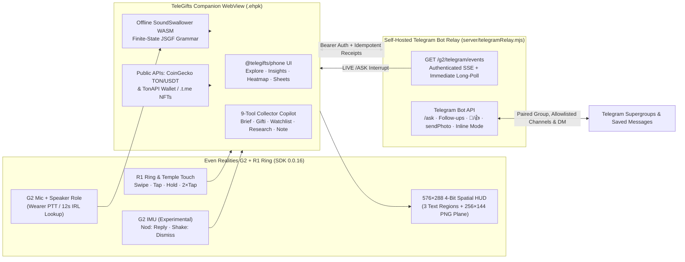

# DoraHacks Submission — TeleGifts G2

- **Hackathon:** [Heads Up: Even Realities Hackathon](https://dorahacks.io/hackathon/even-realities/detail)
- **Primary Track:** `Track 01 — Messaging & News` (`Telegram`: accounts, bots, channels, Mini Apps)
- **Bonus / Cross-Track Category:** `Best Telegram Integration`
- **Target Hardware & SDK:** Even Realities G2 (`576 × 288`, 4-bit optical waveguide) + Even R1 Ring · `@evenrealities/even_hub_sdk@0.0.16`
- **Live Interactive Studio:** https://kingkej.github.io/telegifts-g2-sample/
- **Full Narrated Split-Screen Demo (`01:59`, 1080p, Live Telegram):** [demo/telegifts-g2-demo.mp4](./demo/telegifts-g2-demo.mp4)
- **Live Telegram Loop Highlight (`00:37`, 1080p):** [demo/telegram-live-loop.mp4](./demo/telegram-live-loop.mp4)

---

## 1. One-Line Pitch
**TeleGifts G2** turns Even Realities G2 glasses and the R1 Ring into a heads-up Telegram Gift collectibles terminal and moderator copilot — combining 4-bit optical floor & 5-venue spread charts, live SSE `/ask` interrupts, and 1-tap visual Telegram replies.

---

## 2. Problem & Why Smart Glasses
Telegram Collectible Gifts trade 24/7 across five TON marketplaces (**Portals, Tonnel, MRKT, Getgems, and Fragment**), while collector price discovery happens inside fast-moving Telegram supergroups and forum topics. Constantly pulling out a phone to compare floors across five venues or answer repetitive `/ask` questions breaks focus.

**Even Realities G2** solves this with a tight **Read + Write** micro-interaction loop:
- **Read at a glance:** Brightness-graded (`textColor` `2 / 4 / 3`) 3-region waveguide HUD paired with `256 × 144` 16-shade UTC floor plots, 5-venue horizontal spread bar charts, and tilted 3D gift relief previews.
- **Write in seconds:** When `/ask` or a reply-to-bot follow-up arrives over SSE, deterministic Answer-First Triage (`P1 / P2 / P3`) surfaces urgent Favorite/Watchlist/spread asks on the G2 lens while queuing low-priority chatter silently in a 1-screen `Pending` summary. Tap (sending `👀` + typing/upload status back to Telegram) to open intent-ranked drafts — or hold the **R1 Ring** to voice-pick offline or dictate a custom reply (with strict Tap-to-send) — and post a grounded threaded reply with a 7d or 5-venue spread PNG (marking the ask `👍`). Anyone in any Telegram chat can also invoke `@bot <gift>` via **Inline Mode** for instant snapshot cards.

---

## 3. System Architecture



---

## 4. Even G2 SDK `0.0.16` Hardware Capabilities Used

| Even Hub SDK Primitive | How TeleGifts G2 Uses It | Verification Status |
| --- | --- | --- |
| `createStartUpPageContainer` / `rebuildPageContainer` / `textContainerUpgrade` | 3-region spatial HUD (`header: 2` capped at 72B, `body: 4` with unique `isEventCapture: 1`, `footer: 3`) validated via `validateEvenHubPageContainer` | Browser Studio, Even Hub Simulator & unit tests |
| `updateImageRawData` (`120 × 120` & `256 × 144`) | Streams 16-level grayscale gift artwork, tilted 3D relief models, `24h/7d/30d` UTC floor charts, and 5-venue spread bar charts | Browser Studio, Even Hub Simulator & unit tests |
| `EventSourceType` (`RING`, `GLASSES_R`, `GLASSES_L`) + `LONG_PRESS` | R1 Ring push-to-talk offline draft selection and optional free-form LLM dictation (strict Tap-to-send) in Smart Reply composer + live input-source badge | Browser Studio, Even Hub Simulator & unit tests |
| `audioControl` + `AudioSpeakerRole` (`self` vs `other`) | Offline JSGF voice commands & Ask Gifti for wearer (accepting all glasses PCM during active wearer sessions), plus bounded 12s IRL overheard lookup when idle | Browser Studio & unit tests (not yet tested on physical G2) |
| `imuControl` + `IMU_DATA_REPORT` (`x, y, z`) | **Experimental** power-gated Head-Nod / Head-Shake alert triage enabled strictly during transient `LIVE /ASK` and watch-hit overlays | Browser Studio & unit tests (needs physical G2 calibration) |
| `onLaunchSource` (`glassesMenu` vs `appMenu`) | Early-captured G2 OS menu launch opens straight into the **60s Morning Market Brief (`summary`)** | Browser Studio & unit tests |
| `getLocalStorage` / `setLocalStorage` + `pickImageFromAlbum()` | Hydrates & writes through Favorites, Watchlist baselines, Relay config, and hardware preferences into Even host storage, plus album filename gift matching | Browser Studio & unit tests |

---

## 5. 60-Second Judge Evaluation Guide (Zero API Keys Required)

Open **https://kingkej.github.io/telegifts-g2-sample/** on desktop, or run locally:

```bash
npm install
npm test
npm run dev
```

1. **Interactive G2 Studio (`http://localhost:3000`):**
   - Click **▶ Auto-Tour**, or use the G2 controls (`↑/↓/Enter/Esc/Space` when the lens is focused) and **🎤 Speak G2 Command (Real Mic)** (`16 kHz` WebAudio → offline `soundswallower` WASM).
   - Try the **Offline Gifti Analyst** (unlimited local rule-based queries, or paste an optional 1-time RAM-only `OpenAI / Gemini / Groq` key for live LLM & Whisper).
   - Check **Tools → User portfolio** with `@collector` (explicit synthetic demo) or any real public TON address (`EQ...` / `UQ...` / `.ton`) or Fragment collectible `@username` (live read-only TonAPI).
   - Click **⚡ + Live /ask Alert**, **⚡×3 Burst /asks**, or **📋 Pending** to test deterministic P1/P2/P3 triage, silent P3 queuing, intent-ranked 1-tap Smart Reply, and experimental IMU nod/shake simulation.
2. **Official Even Hub Simulator (`576 × 288`):** Run `npm run simulate` in a second terminal (`evenhub-simulator http://localhost:3000/?raw=1`).
3. **Optional Live Telegram Bot Relay:** Copy `.env.example` to `.env`, set `TELEGRAM_BOT_TOKEN` and `TELEGRAM_BOT_USERNAME` (plus optional `RELAY_ALLOWED_CHANNELS`, `RELAY_STATE_FILE`, and `/setinline` in `@BotFather` for `@bot <gift>` inline mode), run `npm run relay`, and connect in **Explore → Telegram Setup**.

---

## 6. Security, Live-Data Honesty & Provenance
- **Zero Client-Side Secrets:** `TELEGRAM_BOT_TOKEN` stays exclusively in `server/telegramRelay.mjs`. Relay endpoints enforce DNS-rebinding Host checks, Fetch Metadata (`Sec-Fetch-Site`), CORS allowlists, `RELAY_ALLOWED_CHANNELS` gating on `channel_post`, bounded receipt/token maps, and `timingSafeEqual` Bearer auth.
- **Strict Live vs. Snapshot Honesty:** In live Telegram relay mode without a live market feed, synthetic 7d curves are never attached as live facts and outgoing quotes carry explicit `(snapshot)` markers. Real TON wallet lookup failures return an honest error instead of fabricating holdings.
- **Automated Public Audit (`npm run audit:public`):** Walks workspace files (skipping `node_modules/`, `.git/`, `coverage/`, `.vite/`, and `dist/`), enforces filename checks across walked files for `.env*` secret files and forbidden key/sourcemap extensions (`.keystore`, `.jks`, `.pem`, `.key`, `.p12`, `.pfx`, `.map`), runs text content scans on non-binary text files up to 15 MB (skipping binary extensions such as `.png`, `.webp`, `.jpg`, `.jpeg`, `.ico`, `.wasm`, `.bin`, `.ehpk`, `.woff`, `.woff2`, `.mp4`, and SoundSwallower model binaries), and verifies `app.json` manifest compliance plus `vendor/telegifts-phone/NOTICE`.
- **Provenance & Licensing:** Git history was squashed into a clean public release on Nov 25, 2026 (baseline vs hackathon breakdown in [README.md](./README.md#6-hackathon-transparency-disclosure--licensing)). Original repo code is MIT-licensed; the pre-built companion UI in `vendor/telegifts-phone/` is proprietary per [vendor/telegifts-phone/NOTICE](./vendor/telegifts-phone/NOTICE).
